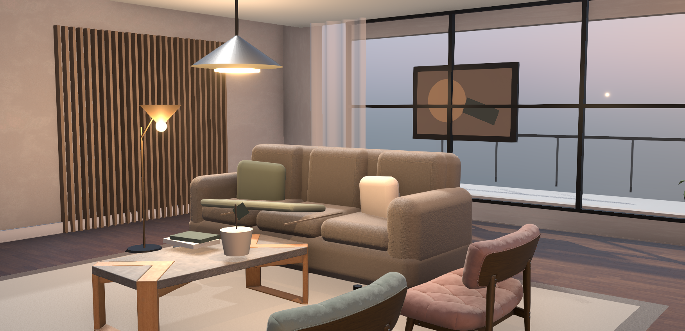
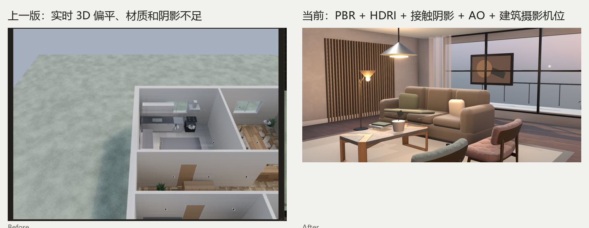

# AI Home Studio

AI Home Studio 是面向家装设计场景的 AI 驱动三维空间设计平台。





当前仓库已经从方案文档进入**可运行的高保真 Web 原型**阶段。

本轮重点解决的是“3D 效果廉价、不真实”：

- 真实 GLB/glTF 家具资产
- 木地板和织物的 PBR 颜色、法线、粗糙度贴图
- HDRI 环境光与反射
- 太阳主光、室内实用灯和软阴影
- 接触阴影与 N8AO 屏幕空间环境光遮蔽
- ACES 色调映射、曝光控制、Bloom 和抗锯齿
- 建筑摄影机位、WASD 第一人称漫游
- 对象选择、材质更换、浏览器 GLB 替换
- 当前画面同步导出 PNG

## 运行

```powershell
npm install
npm run dev
```

打开 `http://127.0.0.1:4173/`。

生产构建：

```powershell
npm run build
npm run preview
```

浏览器验收（先启动独立预览，再在另一个终端运行）：

```powershell
npm run preview -- --port 4174

# 另一个终端
$env:CHROME="C:\Users\<user>\AppData\Local\Google\Chrome\Application\chrome.exe"
npm run test:ui
```

此检查覆盖设计视图、W/A/S/D 移动、材质切换、浏览器 GLB 替换和同步 PNG 导出。

## 已实现

- 内容层：客厅、木饰面、落地窗、阳台、沙发、单椅、茶几、绿植、吊灯和软装
- 渲染层：PBR、HDRI、PBR 法线、软/接触阴影、AO、ACES、Bloom、SMAA
- 交互层：设计/漫游/照片构图、WASD、鼠标拖拽视角、对象选中、材质替换
- 资产层：浏览器 `.glb` 导入与当前对象替换
- 输出层：当前三维画面导出高分辨率 PNG

## 当前限制

- 这仍是实时 WebGL 高保真预览，不是最终 GPU Path Tracing 成图器。
- 当前没有后端项目存储、账号、SKU、价格和真实商品库存。
- 当前第三人称移动仅验证相机漫游，没有墙体碰撞。
- 手机端以预览和属性查看为主，不提供完整三维编辑操作。
- 当前依赖浏览器硬件加速；无可用 WebGL 时会明确显示加载失败。

## 文档

- [产品范围](docs/product-scope.md)
- [技术基线](docs/technical-baseline.md)
- [真实感渲染升级说明](docs/renderer-upgrade.md)
- [构建与验收记录](docs/validation.md)
- [第三方资产许可](ASSET_LICENSES.md)
- [AGENTS.md](AGENTS.md)

## 许可证

本仓库业务代码暂未选定开源许可证；在正式确定商业模式与分发方式前保留全部权利。第三方资产许可见 [ASSET_LICENSES.md](ASSET_LICENSES.md)。
